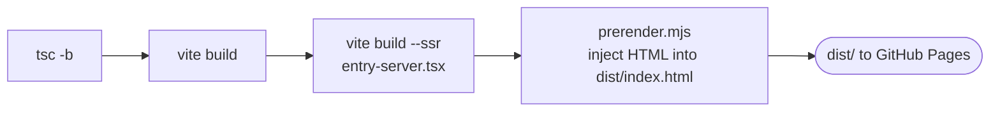

<h1 align="center">Muhammad Faizan Khan - AI Engineering Portfolio</h1>

<p align="center">Personal portfolio site, live at<br>
<a href="https://faizankhan789.github.io/Portfolio/"><b>faizankhan789.github.io/Portfolio</b></a></p>

<p align="center">
  
  
  
  
  
  
</p>

<p align="center">
  <a href="#-stack"><b>Stack</b></a> ·
  <a href="#-develop">Develop</a> ·
  <a href="#-portrait-asset">Portrait asset</a> ·
  <a href="#-deploy">Deploy</a>
</p>

---

## 🧰 Stack

- React + TypeScript, built with Vite (base path `/Portfolio/`)
- Tailwind CSS v4
- GSAP and Lenis for motion and smooth scroll
- Vitest + Testing Library for unit tests, Playwright for end-to-end checks

## 🔁 Build pipeline



`npm run build` type-checks, builds the client, builds an SSR bundle, then prerenders the React tree into `dist/index.html`.

---

## 💻 Develop

```bash
npm install
npm run dev      # local dev server
npm run build    # type-check and production build into dist/
npm run preview  # serve the production build
npm test         # unit tests
npm run e2e      # Playwright tests (run `npx playwright install chromium` once)
```

## 🖼️ Portrait asset

`public/images/portrait-cutout.webp` (the hero mosaic source) is generated from
`source-assets/img.png` with background removal that runs locally:

```bash
pip install rembg pillow numpy scipy   # numpy + scipy clean the matte
python3 -I scripts/make-portrait.py
```

## 🚀 Deploy

Deployment is automatic: push to `main` and the GitHub Actions workflow
(`.github/workflows/static.yml`) builds the site and publishes `dist/` to
GitHub Pages.

`public/Resume.pdf` is the downloadable resume, served at `/Portfolio/Resume.pdf`.
